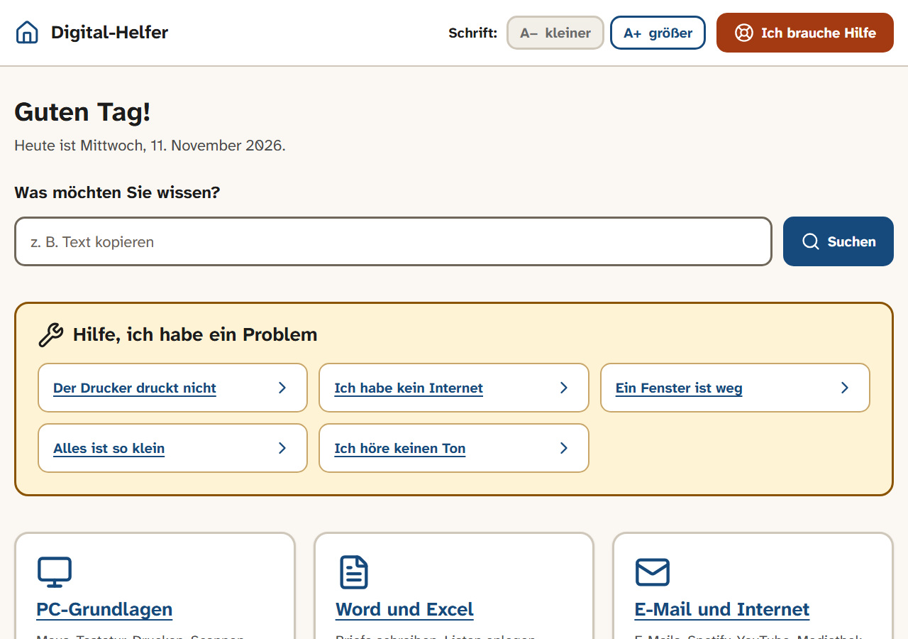
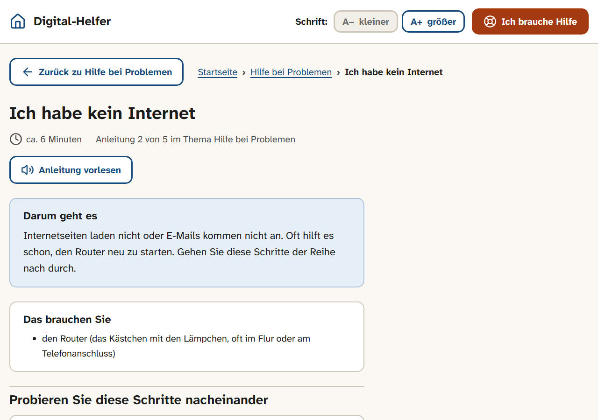

# Digital-Helfer

Digitaler Helfer am PC für ältere Menschen: eine ruhige, übersichtliche Seite mit Anleitungen
für PC, Word und Excel, iPhone, Fotos und Videoanrufe, Online-Alltag, Sicherheit, Bedienhilfen und Künstliche Intelligenz.
Dazu gibt es eine Übungsecke (`/ueben/`), ein kleines Lexikon (`/glossar/`) und einen Spickzettel zum Ausdrucken (`/spickzettel/`, passt auf eine A4-Seite).
Jede Anleitung hat einen Knopf „Anleitung vorlesen“ (Sprachausgabe des Browsers), und die Startseite zeigt „Weiterlesen, wo Sie aufgehört haben“. Alle Texte sind in einfacher Sprache und in Sie-Form.

Gebaut mit [Astro](https://astro.build) (statische Seite), Suche mit [Pagefind](https://pagefind.app).

> **English:** A calm website with step-by-step guides in plain German for older people: PC, smartphone, video calls and online safety. Built for my parents and refined based on their feedback.

**Live:** https://seb-nsu.github.io/Digital-Helfer/





## Meine Rolle und wichtigste Entscheidungen

Die Seite habe ich für meine Eltern gebaut und nach ihren Rückmeldungen überarbeitet. Zielgruppe, Themen, Aufbau der Anleitungen und die Abnahme stammen von mir; den Code haben KI-Agenten (Claude Code) nach meinen Vorgaben geschrieben.

| Entscheidung | Begründung |
| --- | --- |
| Einfache Sprache und Sie-Form in allen Texten | Die Leser sind ältere Menschen ohne Vorwissen |
| Höchstens 9 Themen-Kacheln auf der Startseite | Die Startseite bleibt auf einen Blick erfassbar |
| „Hilfe, ich habe ein Problem“ steht ganz oben | Wer die Seite öffnet, hat oft gerade ein Problem |
| Jede Anleitung lässt sich vorlesen und endet mit „Jetzt Sie!“ | Hören und selbst ausprobieren hilft mehr als nur lesen |
| Name und Telefonnummer der Hilfsperson stehen nicht im Repository | Persönliche Daten kommen erst beim Bauen aus Umgebungsvariablen |
| Suchmaschinen sind ausgesperrt | Die Seite ist für die Familie gedacht, nicht für die Öffentlichkeit |

## Loslegen

```bash
npm install
npm run dev      # Vorschau während der Arbeit: http://localhost:4321/Digital-Helfer/
npm run build    # fertige Seite in dist/ bauen, inklusive Suchindex
npm run preview  # gebaute Seite ansehen (nur hier funktioniert die Suche)
```

Benötigt Node.js 22.23 oder neuer (die Veröffentlichung auf GitHub läuft mit Node.js 24).

## Wichtige Einstellungen

Alles Wichtige steht in [`src/config.ts`](src/config.ts):

- **`NICHT_INDEXIEREN`**: Solange die Seite nur für die Familie ist, sollen Suchmaschinen sie nicht aufnehmen.
- **Themen** (Titel, Kurzbeschreibung, Symbol) für die Startseite. Höchstens 9 Kacheln (3 × 3).

### Name und Telefonnummer der Hilfsperson

Name und Nummer der Person, die hilft, stehen **nicht im Repository**. Sie kommen beim Bauen aus
Umgebungsvariablen (Details in [`src/helfer.mjs`](src/helfer.mjs)):

| Variable | Beispiel | Wofür |
| --- | --- | --- |
| `HELFER_NAME` | `Anna` | Name auf der Hilfe-Seite, dem Spickzettel und in den Anleitungen |
| `HELFER_TELEFON` | `+491701234567` | Knopf „anrufen“ (internationales Format, ohne Leerzeichen) |
| `HELFER_TELEFON_ANZEIGE` | `0170 1234567` | Nummer, wie sie auf der Seite steht |
| `HELFER_WHATSAPP` | `491701234567` | Knopf „bei WhatsApp schreiben“ (nur Ziffern, ohne +) |

- **Auf GitHub:** Settings → Secrets and variables → Actions → Reiter **Variables** → „New repository variable“.
  Der Workflow `deploy.yml` reicht sie beim Bauen weiter.
- **Lokal:** z. B. `HELFER_NAME=Anna npm run dev`.
- Ohne `HELFER_NAME` steht auf der Seite „Ihre Vertrauensperson“. Ohne Telefonnummer zeigt die Hilfe-Seite
  keine Knöpfe zum Anrufen und für WhatsApp.

In den Anleitungen schreiben Sie statt eines Namens `{{helfer}}` (z. B. „Fragen Sie {{helfer}}“) oder
`{{helfer-dativ}}` (z. B. „mit {{helfer-dativ}}“).

> Achtung: Die fertige Webseite ist öffentlich. Was in den Variablen steht, kann jeder auf der Seite sehen.

## Eine neue Anleitung schreiben

Jede Anleitung ist eine Markdown-Datei in `src/content/lektionen/<thema>/`. Der Dateiname wird zur Adresse
(`office/word-brief.md` → `/office/word-brief/`). Kopfdaten:

```yaml
---
titel: Wie kopiere ich einen Text?        # als Frage oder Aufgabe
thema: pc-grundlagen                     # pc-grundlagen | office | internet | iphone | familie | alltag | sicherheit | bedienhilfen | ki | probleme
nummer: 4                                # Reihenfolge im Thema (jede Nummer nur einmal je Thema)
niveau: Einsteiger                       # oder Fortgeschritten (zeigt das Etikett „Für Fortgeschrittene“)
gruppe: Word                             # optional: Abschnitt auf der Themenseite; die Nummern in der Liste zählen je Abschnitt
dauer: 6                                 # Minuten
darum: Ein bis zwei Sätze, worum es geht.
brauchen:
  - einen Text, zum Beispiel in Word
suchwoerter: [kopieren, Strg C, doppeln]  # Alltagswörter für die Suche
---
```

Aufbau des Textes:

- `## Überschrift` gliedert die Anleitung.
- **Nummerierte Listen** (`1.`, `2.` …) werden automatisch zu Schritt-Karten.
- `> **Gut zu wissen:** …` wird zu einem blauen Hinweis-Kasten.
- `<div class="warnung">` … `</div>` (mit Leerzeilen davor und danach) wird zu einem Warn-Kasten.
- Tasten schreiben Sie als `<kbd>Strg</kbd> + <kbd>C</kbd>`.
- Bildschirmfotos legen Sie neben die Datei und binden sie mit `` in einen Schritt ein.
- Links ins Glossar: `[Browser](../../glossar/#browser)`. In der Anleitung öffnet ein Klick darauf die Erklärung direkt unter dem Absatz.
  Zu einer anderen Anleitung: `[Text](../rueckgaengig/)`.
- Jede Anleitung endet mit `## Jetzt Sie!` und, wenn sinnvoll, `## Hat nicht geklappt?`.

Fachwörter für die Seite „Wörter erklärt“ stehen in `src/content/glossar.yaml`.

## Veröffentlichen

Jede Änderung in `main` wird automatisch auf GitHub Pages veröffentlicht
(Workflow `.github/workflows/deploy.yml`). Die Adresse ist
**https://seb-nsu.github.io/Digital-Helfer/**.

Einmalig einschalten: im Repository unter **Settings → Pages** bei **Source** „GitHub Actions“ wählen.

> Die Seite ist dann öffentlich erreichbar. Suchmaschinen sind über `NICHT_INDEXIEREN` in `src/config.ts` ausgesperrt.

### Am PC einrichten

1. **Startseite im Browser (Edge):** Einstellungen → „Start, Startseite und neue Tabs“ → „Diese Seiten öffnen“ →
   „Neue Seite hinzufügen“ → Adresse oben einfügen.
2. **Symbol auf dem Desktop:** Seite in Edge öffnen → Menü „…“ → „Weitere Tools“ → „Verknüpfung erstellen“
   (oder rechte Maustaste auf den Desktop → „Neu“ → „Verknüpfung“ → Adresse einfügen → Name „Digital-Helfer“).
3. Auf dem iPhone: Seite in Safari öffnen → Teilen → „Zum Home-Bildschirm“.

Lokal lässt sich der Basis-Pfad beim Bauen mit `BASE_PATH` ändern, die Domain mit `SITE_URL`.

## Lizenz

[MIT](LICENSE)
